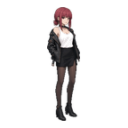
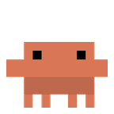
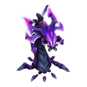
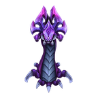
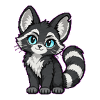

# Snapshot 公开素材库

[浏览仓库](https://github.com/Maxwilldoit/Pets) · [下载素材包](https://github.com/Maxwilldoit/Pets/releases/tag/snapshot-assets-v1) · [机器可读目录](../catalog.json)

这里维护 Snapshot 可下载的桌宠素材：**目录、预览图与动作清单进 Git，供应用下载的 GIF ZIP 放在 GitHub Releases**。原始 ZIP 同时保存在 [`sources/archives/`](../sources/archives/)，桌面端宠物包保存在 [`pets/`](../pets/)。应用按需下载，安装包无需携带全部素材。当前目录包含 10 套素材。

在 Snapshot「桌面伴侣 → 素材库」中浏览并导入。也可从 Release 下载 ZIP，再拖进「桌面伴侣」页。导入后素材保存在应用数据目录；同一只从库里重新导入会更新素材并保留自定义名字。

| 素材 | 预览 | 特点 |
|---|---|---|
| 玛奇玛 · 像素 |  | 挥手、思考、探头 |
| 山田 · 店员 |  | 店员与日常装扮 |
| 山田 · 像素 |  | 日常动作、坐下休息 |
| Clawd |  | 工作、成功、报错、睡觉 |
| 纳什 · 初版 |  | 展示、升星、胜利 |
| 纳什 · 进阶 |  | 钻地、连招、胜利 |
| 双燕 · 箱中搭档 |  | 等待、审阅、失败 |
| Hoop 23 |  | 运球、后仰、扣篮 |
| Kuro · 持刀客 |  | 挥手、拔刀、探头 |
| Momo |  | 待机、走路、挥手 |

## 格式与下载

根目录的 `catalog.json` 使用 `version: 1`，`assets` 每项包含：稳定 `id`、显示名、简介、标签、素材 `version`、Release 文件名 `file`、`sizeBytes`、`sha256`、`downloadUrl`、`previewUrl`、`licenseStatus`。`sourceSha256` 记录构建用原包的校验值，便于追溯。

- ZIP 仅含 GIF、根级 `pet.json` 和 `ASSET-LICENSE.txt`；不带应用设置、凭证或生成用中间素材。
- 应用只从本仓库的目录和 Release 读取，限制包大小为 100 MB，核对实际字节数和 SHA-256 后再导入。
- 下载失败或校验失败可以重试。导入后的宠物离线可用。
- 本目录的 `pet.json` 是 **Snapshot 的事件/锚点格式**。`pets/<id>/pet.json` 是本仓库 Electron 桌面端的格式，两者有各自的读取入口；本版在线导入入口位于 Snapshot。

## 给素材作者：按事件设计动作

推荐先画待机、工作中、休息、成功、失败，再按主题细分。动作短、含义清楚比每个事件各画一套更有用。没有合适动作的事件可以不映射；当前部分角色未提供失败或录制中的专用动作。

| 触发 | 清单键 | 适合的动作 |
|---|---|---|
| 截图完成 / 失败 | `capture.success` / `capture.failure` | 挥手、举相机 / 疑惑、失落 |
| 开始 / 停止 / 录制失败 | `recording.started` / `recording.stopped` / `recording.failure` | 准备、庆祝 / 报错 |
| 润色完成 / 失败 | `polish.success` / `polish.failure` | 点头、亮灯 / 疑惑 |
| 手动暂停 / 恢复快捷键 | `shortcuts.paused` / `shortcuts.resumed` | 打盹 / 醒来、招手 |
| 持续录制中 | `states.recording` | 敲键盘、思考、安静工作 |
| 持续手动暂停 | `states.shortcuts-paused` | 睡觉、坐下休息 |

`events` 是约 2.6 秒的一次性反馈，`states` 在状态持续期间循环播放。优先级为手动暂停 > 录制中 > 一次性反馈 > 点击或拖动 > 待机。暂停状态来自用户手动开关。

根级 `pet.json` 示例（路径必须是包内真实的 GIF）：

```json
{
  "version": 1,
  "base": { "width": 256, "height": 256, "anchor": [128, 240] },
  "animations": {
    "idle.gif": { "anchor": [128, 240] },
    "feedback/success.gif": { "anchor": [128, 240] },
    "feedback/working.gif": { "anchor": [128, 240] },
    "feedback/sleeping.gif": { "anchor": [128, 240] }
  },
  "events": { "capture.success": "feedback/success.gif", "polish.success": "feedback/success.gif" },
  "states": { "recording": "feedback/working.gif", "shortcuts-paused": "feedback/sleeping.gif" }
}
```

锚点表示脚底位置，单位是 GIF 像素。大画布动作应给单独锚点，动作切换时人物保持原来的比例与位置。Hoop 23 的发布包保留原始锚点。横穿宽画布的走路素材在构建时转换为与待机同画布的原地走。

Snapshot 会从点击轮播中排除事件专用 GIF。本库把反馈动作复制到 `feedback/` 再映射，因此原动作仍可通过点击预览。实际例子见 [manifests/](manifests/)。完整协议也见 [Snapshot 使用说明](https://github.com/Maxwilldoit/Snapshot/blob/cursor/pet-animation-window-3f1f/README.zh-CN.md)。

## 维护与发布

1. 在 `sources.json` 明确列出本次允许发布的原 ZIP、显示信息及动作映射。构建脚本仅处理清单列出的文件。
2. 准备 Python 3.10+ 和 Pillow 10+。使用仓库保存的原 ZIP，运行：

   ```sh
   python -m pip install Pillow
   python scripts/build-snapshot-library.py --source-dir sources/archives
   python scripts/build-snapshot-library.py --check --archives
   ```

3. 检查 `catalog/previews/`、`catalog/manifests/`、生成的目录和 `dist/snapshot-assets-v1/`。包中自动写入 `ASSET-LICENSE.txt`；发布前确认适用许可和公开范围。
4. 在对应 tag 的 GitHub Release 上传生成的 ZIP 和 `SHA256SUMS.txt`。发布后下载核对，再提交或更新目录供应用发现。新版本应使用新的素材版本号/Release tag，不要覆盖旧版本文件。
5. 提交目录、预览、清单、脚本与 `sources/archives/` 中的原包；生成的 `dist/` 不进 Git。CI 运行不依赖原包的 `--check`。

固定 ZIP 时间戳和文件排序使同一工具版本的构建可复现。换 Pillow 版本重新编码走路 GIF 时，哈希可能变化，需要按新素材版本发布。

## 素材许可

当前 10 套素材均标记为「未单独声明素材许可」。公开下载不等于授予开放许可或商业使用许可；此说明没有替任何角色、品牌或素材权利人作出授权。代码许可与素材许可分别管理。后续贡献应附上作者、来源和明确的适用许可。
